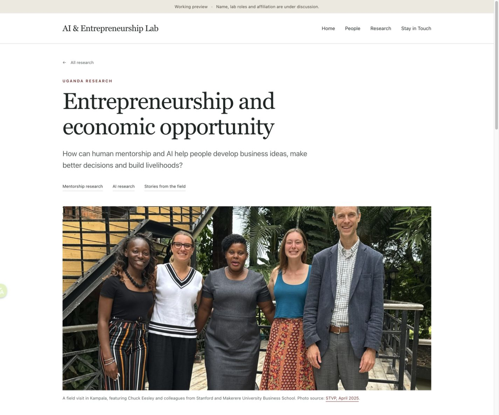

# AI & Entrepreneurship Lab website

Private collaboration repository for a proposed lab website. The working name, lab roles and institutional affiliation are still under discussion.

The site is plain HTML and CSS. No package installation or build step is required.

## Preview the website

Clone this repository and open `index.html` in your browser. You can also run:

```sh
python3 -m http.server 8767 --bind 127.0.0.1
```

Then visit <http://127.0.0.1:8767/>. Stop the server with `Ctrl+C`.

GitHub displays HTML source files. To see the rendered website, open the downloaded files or use the local preview command. GitHub Pages is not configured.

## What to edit

| File | Content |
| --- | --- |
| `index.html` | Homepage, About, People and research entry |
| `research.html` | Research index |
| `uganda.html` | Uganda research page |
| `styles.css` | Shared layout, colors and responsive styles |
| `assets/` | Photographs used by the website |
| [docs/SOURCES.md](docs/SOURCES.md) | Public sources and photo credits |

## Collaborate

Use an issue to suggest content or report a problem. For edits, create a branch and open a pull request for review. Small text changes can be made with GitHub's file editor; choose a new branch when saving.

See [CONTRIBUTING.md](CONTRIBUTING.md) for the editing workflow and current content decisions. Repository access is managed by the owner through **Settings → Collaborators**; a private repository link alone does not grant access.

## Current content

- People lists Chuck Eesley, with placeholders for additional members.
- The Uganda page separates the established mentorship study from the planned AI advice study and the separate prospective savings-group pilot.
- The contact section is a placeholder. Personal contact details should not be added without an agreed change.
- The site remains a working preview. Uploading source to this private repository does not launch an official Stanford website.

The photographs have visible source credits. Permission for public republication has not been established; see [source notes](docs/SOURCES.md). No open-source license is assigned to third-party images or the site in this repository.

## Preview



This image records the October 29, 2026 layout. The HTML files are the editable source.
