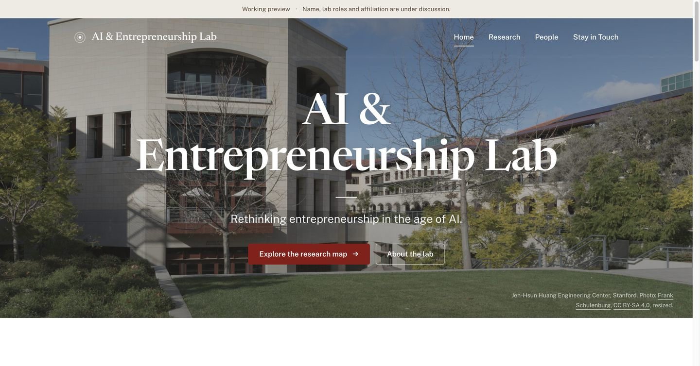
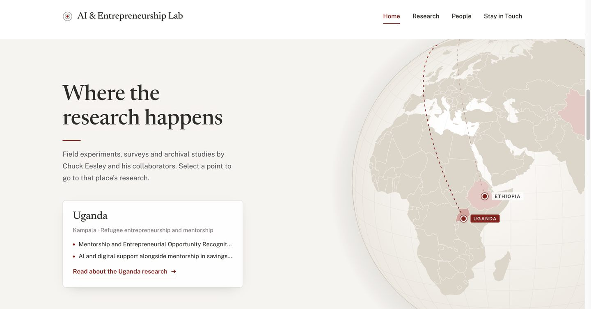
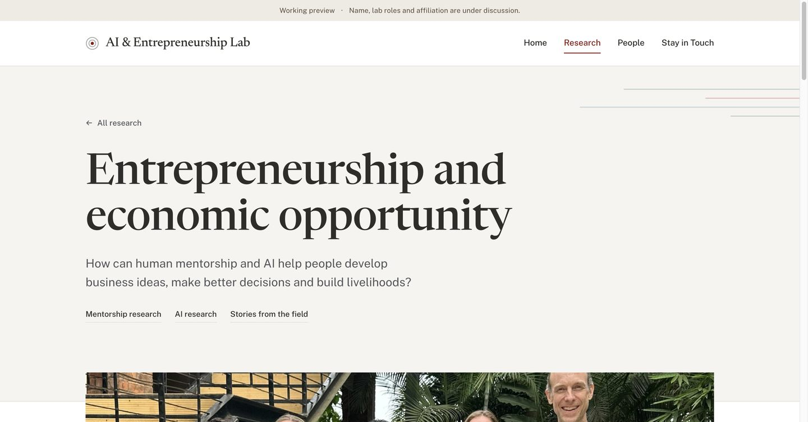

# AI & Entrepreneurship Lab website

Private collaboration repository for a proposed lab website. The working name, lab roles and institutional affiliation are still under discussion.

The site is plain HTML and CSS. No package installation or build step is required.

## Preview the website

Clone this repository and open `index.html` in your browser. You can also run:

```sh
python3 -m http.server 8767 --bind 127.0.0.1
```

Then visit <http://127.0.0.1:8767/>. Stop the server with `Ctrl+C`.

GitHub displays HTML source files. To see the rendered website, open the downloaded files or use the local preview command. GitHub Pages is not configured.

## What to edit

| File | Content |
| --- | --- |
| `index.html` | Homepage: photo hero, About, research globe, featured research, People |
| `research.html` | Research index and the list of studies by place (`#place-…` anchors) |
| `uganda.html` | Uganda research page |
| `styles.css` | Shared layout, colours, type and responsive styles |
| `assets/js/research-data.js` | Places and studies: citations, sources, status and the page each place links to |
| `assets/js/globe.js` | Rotating research globe on the homepage |
| `assets/js/research-list.js` | Studies-by-place list on `research.html` |
| `assets/` | Photographs, fonts and the map libraries (`assets/vendor/`) |
| [docs/STYLE.md](docs/STYLE.md) | Style contract: type, colour, layout and map rules |
| [docs/SOURCES.md](docs/SOURCES.md) | Public sources, photo credits and licences |

## Collaborate

Use an issue to suggest content or report a problem. For edits, create a branch and open a pull request for review. Small text changes can be made with GitHub's file editor; choose a new branch when saving.

See [CONTRIBUTING.md](CONTRIBUTING.md) for the editing workflow and current content decisions. Repository access is managed by the owner through **Settings → Collaborators**; a private repository link alone does not grant access.

## Current content

- People lists Chuck Eesley, Tess Lallemant, Yikai Cao, Ronald Wang, Guankai Zhai and Xilan Zhang (faculty, then postdoctoral fellows, then students by last name), plus a placeholder for additional members.
- The homepage globe places each study by Chuck Eesley and collaborators where its data were collected. To add or correct a study, edit `assets/js/research-data.js`; every entry needs a public source link.
- The Uganda page separates the established mentorship study from the planned AI advice study and the separate prospective savings-group pilot.
- The contact section is a placeholder. Personal contact details should not be added without an agreed change.
- The site remains a working preview. Uploading source to this private repository does not launch an official Stanford website.

The photographs have visible source credits. Permission for public republication has not been established; see [source notes](docs/SOURCES.md). No open-source license is assigned to third-party images or the site in this repository.

## Preview

Screenshots recorded on October 30, 2026 at 1440 px wide. The HTML files are the editable source.






